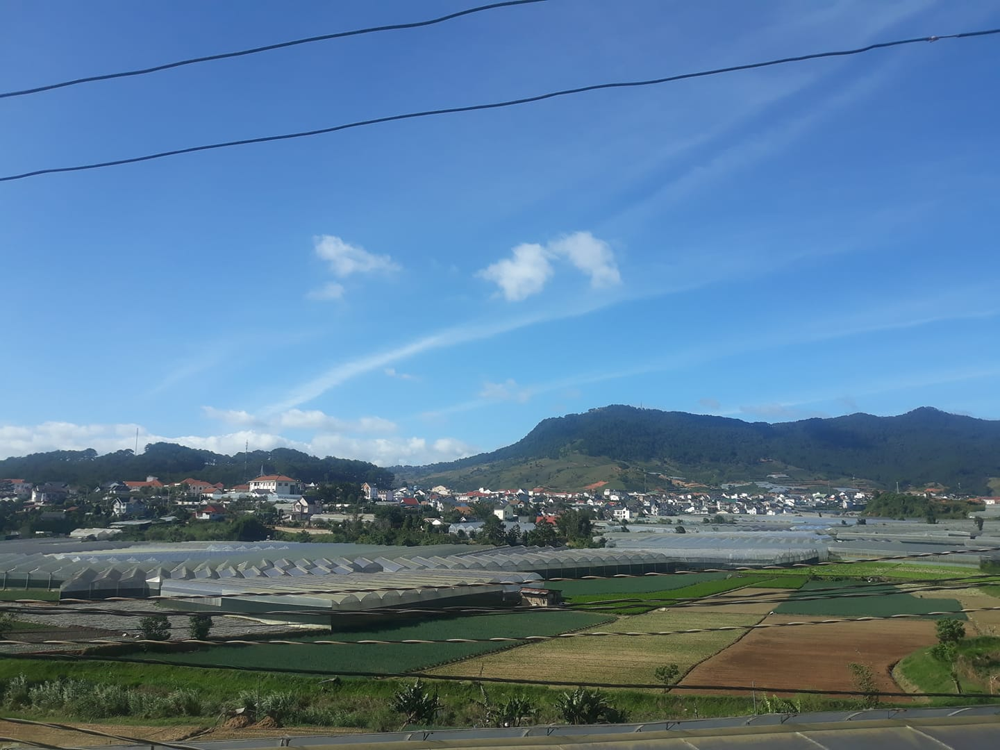

# 🚗 Vehicle Speed Estimation
### 📹 Real-Time Computer Vision-Based Traffic Speed Measurement System

[](#)
[](#)
[](#)
[](https://opensource.org/licenses/MIT)

---

## 🖼️ Demo & Hình Ảnh Dự Án
<div align="center">
  
  <p><i>Hệ thống ước lượng tốc độ phương tiện từ luồng video camera giao thông qua Perspective Transform</i></p>
</div>

---

## 🏛️ Kiến Trúc Hệ Thống (3 Dòng)
- **1. Tầng Thu Thập & Video Stream:** Thu nhận luồng video thời gian thực từ camera giao thông góc nhìn cố định hoặc thiết bị di động.
- **2. Tầng Xử Lý & Mô Hình AI Lõi:** Định vị phương tiện (Detection), duy trì ID theo vết liên tục (Centroid/Deep Tracking) và chuyển đổi tọa độ từ pixel sang khoảng cách thực địa qua ma trận Bird's-Eye View (Perspective Transform).
- **3. Tầng Chấp Hành & Trực Quan Hóa:** Tính đạo hàm vị trí theo thời gian ($v = \Delta s / \Delta t$) để xuất vận tốc chuẩn xác (km/h) hiển thị trực tiếp lên khung hình overlay kèm cảnh báo vi phạm.

---

## 🚀 Cách Chạy (Quickstart)
```bash
# 1. Clone repository
git clone https://github.com/baolam/vehicle-speed-estimation.git
cd vehicle-speed-estimation

# 2. Cài đặt các thư viện phụ thuộc
pip install opencv-python numpy scipy matplotlib

# 3. Khởi chạy server phân tích vận tốc
cd server
python main.py
```

---

## 📊 Số Liệu & Benchmark (Key Metrics)
- **Độ chính xác đo vận tốc:** Độ lệch trung bình dưới **±3.2 km/h** so với súng bắn tốc độ chuẩn trong phạm vi hiệu chuẩn 50m.
- **Tốc độ xử lý khung hình:** Đạt **30+ FPS** thời gian thực trên vi xử lý thông dụng mà không cần phần cứng radar chuyên dụng đắt tiền.
- **Khả năng duy trì ID:** Khả năng bám vết và giữ ID chuyển động ổn định qua các khung hình liên tiếp đạt trên **94%**.
