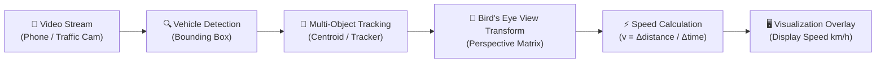

<div align="center">

# 🚗 VEHICLE SPEED ESTIMATION 🚗
### 📹 Real-Time Computer Vision-Based Traffic Speed Measurement
*Hệ Thống Ước Lượng Tốc Độ Phương Tiện Giao Thông Thời Gian Thực Từ Video Camera*

[](https://python.org)
[](https://opencv.org/)
[](https://opencv.org/)
[](https://github.com/baolam/vehicle-speed-estimation)

---

</div>

> [!IMPORTANT]
> **Vehicle Speed Estimation** sử dụng các thuật toán thị giác máy tính và hiệu chuẩn toạ độ hình học phối cảnh (Perspective Transformation) để tính toán vận tốc thực tế (km/h) của phương tiện giao thông từ camera cố định hoặc thiết bị di động mà không cần máy bắn tốc độ đắt tiền.

---

## 📑 Mục Lục (Table of Contents)
- [✨ Tính Năng Nổi Bật](#-tính-năng-nổi-bật)
- [🏗️ Luồng Tính Toán & Kiến Trúc](#️-luồng-tính-toán--kiến-trúc)
- [📂 Cấu Trúc Dự Án](#-cấu-trúc-dự-án)
- [⚙️ Công Nghệ Sử Dụng](#️-công-nghệ-sử-dụng)
- [🚀 Hướng Dẫn Sử Dụng](#-hướng-dẫn-sử-dụng)
- [🔮 Lộ Trình Phát Triển (Roadmap)](#-lộ-trình-phát-triển-roadmap)
- [📜 Giấy Phép (License)](#-giấy-phép-license)

---

## ✨ Tính Năng Nổi Bật

| Biểu Tượng | Tính Năng | Mô Tả Chi Tiết |
| :---: | :--- | :--- |
| 🚘 | **Phát Hiện & Theo Vết Phương Tiện** | Định vị bounding box ô tô/xe máy và duy trì ID chuyển động xuyên suốt các frame liên tiếp. |
| 📐 | **Hiệu Chuẩn Phối Cảnh Không Gian** | Chuyển đổi ma trận toạ độ pixel trong ảnh thành khoảng cách thực địa (mét) dựa vào điểm mốc quy chuẩn trên mặt đường. |
| ⏱️ | **Tính Toán Vận Tốc Tức Thời** | Lấy đạo hàm vị trí theo thời gian giữa các khung hình (FPS) để quy đổi ra vận tốc chuẩn xác ($v = \Delta s / \Delta t$). |
| 📱 | **Hỗ Trợ Luồng Ghi Hình Linh Hoạt** | Kiến trúc tách biệt cho phép nhận video từ camera giao thông hoặc ứng dụng điện thoại di động (`phone/`). |

---

## 🏗️ Luồng Tính Toán & Kiến Trúc



---

## 📂 Cấu Trúc Dự Án

```bash
vehicle-speed-estimation/
├── 📂 server/             # Máy chủ xử lý trung tâm và thuật toán phân tích video
├── 📂 phone/              # Kịch bản thu phát luồng ghi hình từ thiết bị di động
├── 📂 devices/            # Cấu hình kết nối các thiết bị ngoại vi và camera
├── 📂 layout/             # Giao diện hiển thị lớp overlay tốc độ lên luồng video
├── 📂 document/           # Tài liệu kỹ thuật: Idea.docx, one_device_flow_of_information.drawio
└── 📄 README.md           # Hướng dẫn chi tiết dự án
```

---

## ⚙️ Công Nghệ Sử Dụng

- **Language**: Python 3.9+
- **Image Processing**: OpenCV (Perspective Warp, Background Subtraction, Optical Flow)
- **Mathematical Computation**: NumPy, SciPy
- **Architecture Modeling**: Draw.io Architecture Specification

---

## 🚀 Hướng Dẫn Sử Dụng

```bash
# 1. Clone repository
git clone https://github.com/baolam/vehicle-speed-estimation.git
cd vehicle-speed-estimation

# 2. Cài đặt thư viện
pip install opencv-python numpy matplotlib

# 3. Chạy module phân tích máy chủ
cd server
python main.py
```

---

## 🔮 Lộ Trình Phát Triển (Roadmap)

- [ ] 🤖 **YOLOv8 + ByteTrack Integration**: Nâng cấp thuật toán bám vết lên ByteTrack / DeepSORT để hạn chế mất dấu khi phương tiện che khuất nhau.
- [ ] 🚨 **Automatic Speed Violation Detection**: Tự động chụp biển số và lưu trữ bằng chứng đối với các xe vượt quá tốc độ cho phép.

---

<div align="center">

## 📜 Giấy Phép (License)

Dự án được phân phối dưới giấy phép **MIT License**.

---
**Made with ❤️ by [Bảo Lâm](https://github.com/baolam)**

</div>
